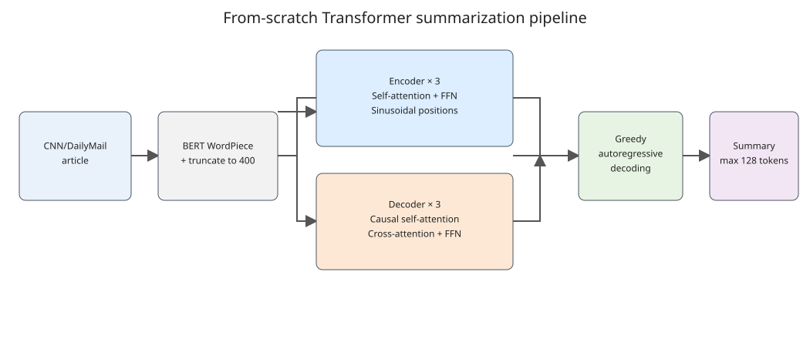
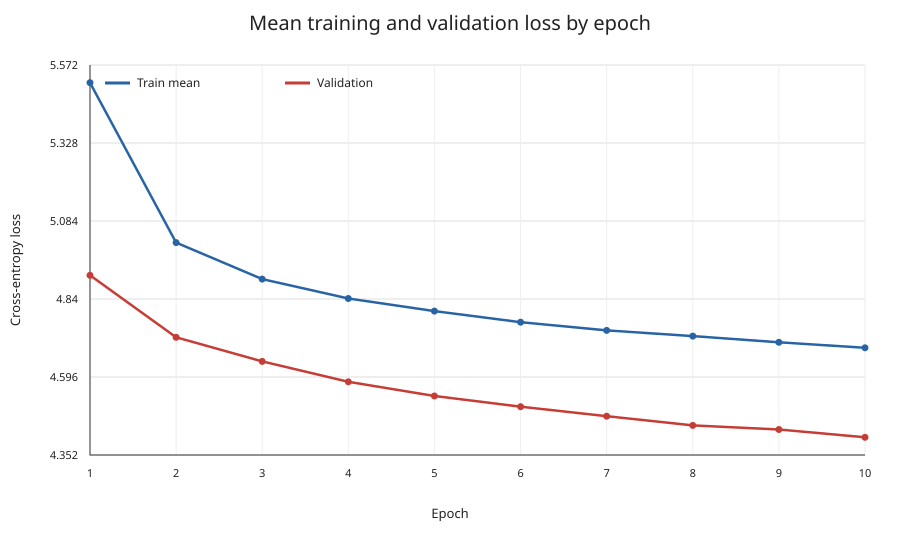
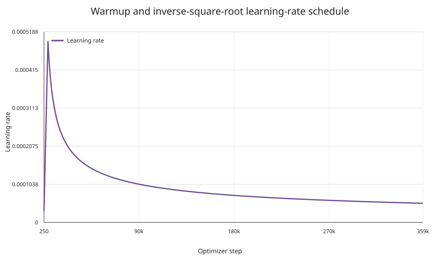
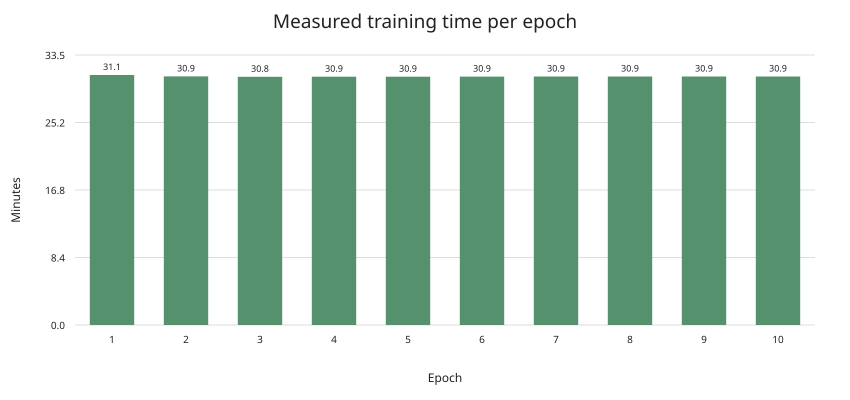
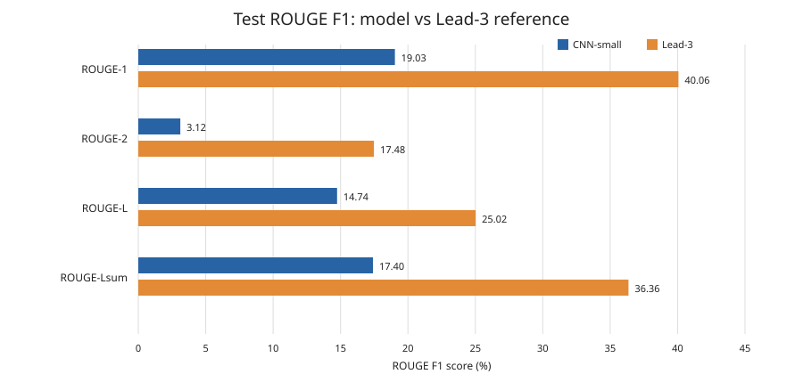
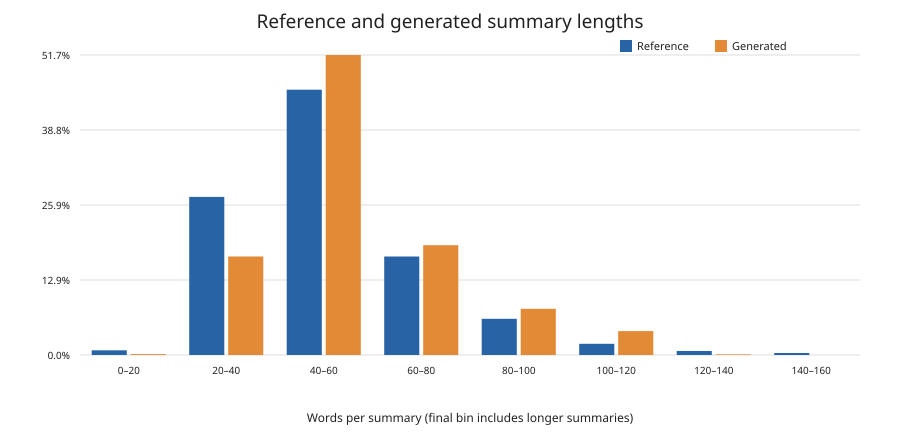
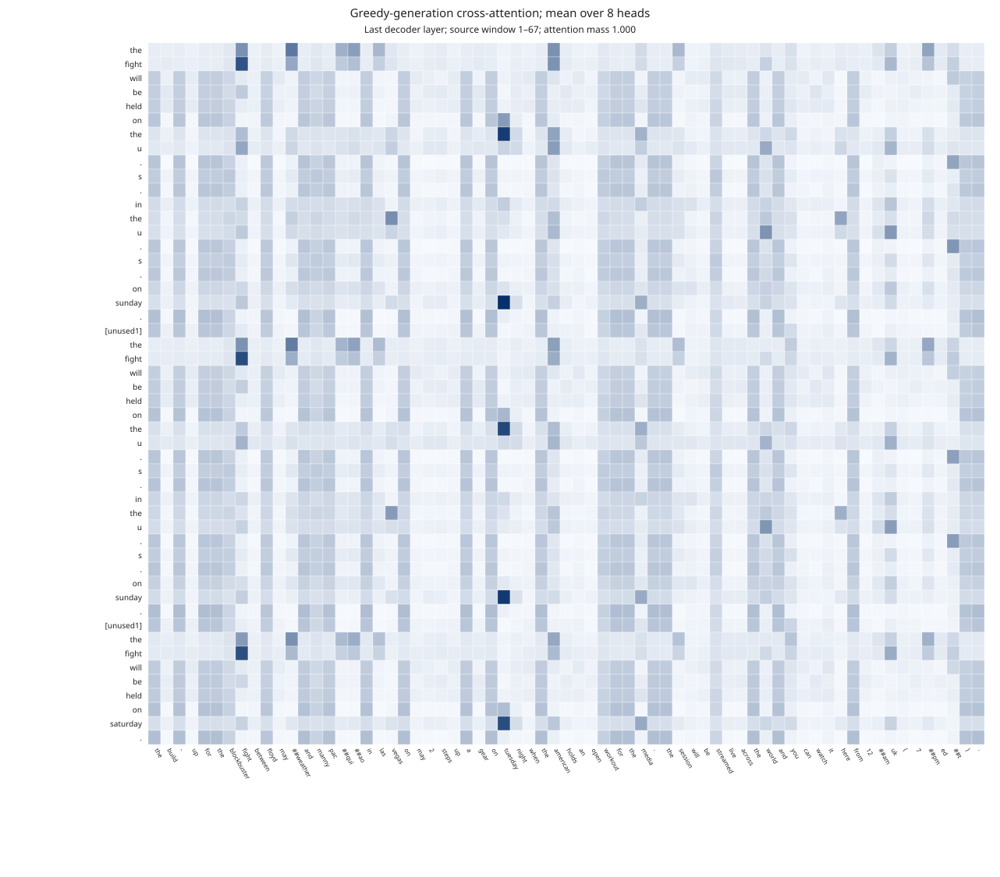

# From-Scratch Transformer for CNN/DailyMail Summarization

## Abstract

We implemented and trained a small Transformer encoder–decoder from scratch for abstractive news summarization on CNN/DailyMail 3.0.0. The model trained on all 287,113 training examples and selected its checkpoint using validation cross-entropy. On the complete 11,490-example test split, greedy decoding achieved ROUGE-1 19.03, ROUGE-2 3.12, ROUGE-L 14.74, and ROUGE-Lsum 17.40 F1. These results are well below the assignment’s Lead-3 reference. The generated examples show both a close match and severe repetition and factuality failures.

## 1. Objective and dataset

The task is to generate a short, coherent highlights section from a news article. We used CNN/DailyMail version 3.0.0 with its prescribed split sizes:

| Split | Examples | Use |
|---|---:|---|
| Train | 287,113 | Parameter updates |
| Validation | 13,368 | Loss monitoring and checkpoint selection |
| Test | 11,490 | Final ROUGE and qualitative evaluation only |

All available training examples were used. Test examples were not used for training or model selection. The final evaluation used the validation-selected best checkpoint.

## 2. Preprocessing

We used the uncased BERT WordPiece tokenizer (`bert-base-uncased`) as a tokenizer only; no pretrained model weights were used. One shared vocabulary encodes article and summary text. Articles are truncated to 400 tokens. Summaries are truncated to 128 tokens, including start and end tokens. Padding tokens are masked in attention and excluded from cross-entropy loss.

The tokenizer maps `[CLS]` to BOS and `[SEP]` to EOS. A reserved `[unused1]` token represents each newline between reference highlight sentences. Decoding restores these newlines, which supports ROUGE-Lsum sentence handling. The model uses teacher forcing during training: decoder inputs are shifted right, targets are shifted left, and the causal mask blocks future target positions.

The stored token-length statistics are measured after truncation; they cannot show how many original articles exceeded the source limit. Source truncation can remove later article details. Summary truncation can remove later reference sentences.

## 3. Model architecture

The model contains 13,343,232 trainable parameters. It uses a 256-dimensional hidden state, 8 attention heads, 3 encoder layers, 3 decoder layers, and a 1,024-dimensional feed-forward layer. Dropout is 0.1. Input and output embeddings are tied.

Each encoder layer has multi-head self-attention and a position-wise feed-forward network. Each decoder layer has masked self-attention, encoder–decoder cross-attention, and a feed-forward network. Sinusoidal positional encodings are added to token embeddings. Residual connections use post-layer normalization. Attention, feed-forward, positional encoding, encoder layers, and decoder layers are implemented with basic PyTorch tensor operations and layers.

## 4. Training setup

Training used PyTorch 2.6.0 with CUDA 12.4 on an NVIDIA GeForce RTX 3060 12 GB. The run used batch size 8 and completed 10 epochs, or 358,900 optimizer steps. It took 18,531.8 seconds, about 5.15 hours. Early-stopping patience was 3 epochs; validation loss improved at every epoch, so patience did not stop this run early.

The optimizer was Adam with β=(0.9, 0.98) and ε=1e-9. Learning rate followed the paper’s warmup and inverse-square-root schedule, multiplied by 0.5, with 4,000 warmup steps. Training used token-level cross-entropy, ignored PAD positions, and used teacher forcing. The best validation checkpoint was saved at step 358,900 with validation loss 4.4073 and validation perplexity 82.04.

| Epoch | Mean train loss | Validation loss | Validation perplexity |
|---:|---:|---:|---:|
| 1 | 5.5164 | 4.9140 | 136.19 |
| 2 | 5.0163 | 4.7201 | 112.18 |
| 3 | 4.9019 | 4.6445 | 104.01 |
| 4 | 4.8413 | 4.5809 | 97.60 |
| 5 | 4.8019 | 4.5363 | 93.34 |
| 6 | 4.7672 | 4.5029 | 90.28 |
| 7 | 4.7416 | 4.4733 | 87.64 |
| 8 | 4.7238 | 4.4444 | 85.15 |
| 9 | 4.7043 | 4.4317 | 84.07 |
| 10 | 4.6873 | 4.4073 | 82.04 |

The full per-step curve is also available at [`loss_curves.svg`](../results/cnn-small/loss_curves.svg). Learning rate and measured epoch durations are shown below.

## 5. Test evaluation

The best-validation checkpoint generated summaries autoregressively with plain greedy decoding. The encoder ran once per article; the decoder appended one predicted token at a time until EOS or the 128-token limit. ROUGE used stemming. Values below are F1 percentages. The Lead-3 figures are the full-test reference scores supplied in the assignment.

| System | ROUGE-1 | ROUGE-2 | ROUGE-L | ROUGE-Lsum |
|---|---:|---:|---:|---:|
| CNN-small, full test (n=11,490) | 19.03 | 3.12 | 14.74 | 17.40 |
| Lead-3 reference | 40.06 | 17.48 | 25.02 | 36.36 |
| CNN-small minus Lead-3 | −21.03 | −14.36 | −10.28 | −18.96 |

The model falls below Lead-3 on all four metrics. The weak ROUGE-2 score indicates limited phrase overlap. ROUGE-L and ROUGE-Lsum also show that generated sequences often fail to preserve the reference content and sentence-level structure. The curated outputs reveal repetition loops, wrong event details, and unsupported claims. A small model trained from scratch, 400-token source truncation, and greedy decoding are plausible contributors; this experiment does not isolate their individual effects.

Length chart counts whitespace-like words, not WordPiece tokens. Its companion statistics are in [`summary_length_stats.json`](figures/summary_length_stats.json).

## 6. Qualitative analysis

The curated appendix contains five distinct held-out examples with article excerpts, references, generated summaries, and manual notes: [`qualitative_examples.md`](../results/cnn-small/qualitative_examples.md). One page-description example closely matches its reference. Other examples demonstrate:

- **Repetition:** one output repeats `dr.` throughout; another repeats the WordPiece-derived fragment `al`.
- **Wrong event and score:** one output says Manchester United beat West Ham 2–0, while its reference reports a 3–0 loss to Everton.
- **Unsupported content:** the prom example invents a “new girlfriend” and repeats an unrelated “more likely” claim.
- **Mixed behavior:** the Manchester example later mentions Everton, but contradicts itself with the invented West Ham result.

These five examples were deliberately selected to show observed behaviors. They are not a random sample and do not estimate the frequency of each error across the test set.

## 7. Attention visualization

The heatmap records encoder–decoder cross-attention during greedy generation, from the last decoder layer. It averages the 8 heads. Rows are generated summary tokens; columns are source tokens. The displayed 75-token source window has the largest total attention mass in that example. Attention indicates token alignment, not proof that a token caused a prediction.

## 8. Limitations and interpretation

- The model is much smaller than the Transformer-base configuration and has one training seed. Results have no multi-seed variance estimate.
- Truncating articles at 400 tokens removes later content. Summaries stop at 128 tokens.
- Greedy decoding can repeat phrases and cannot revise earlier tokens. Beam search was not evaluated.
- The test results are substantially below Lead-3. The output review confirms factual errors and repetition, so ROUGE alone does not capture the full quality problem.
- The curated qualitative examples are diagnostic, not statistically representative.
- No small-versus-large model comparison was required or performed.

## 9. Reproducibility and artifact map

The run configuration, history, checkpoints, complete prediction file, metrics, qualitative review, and visualization artifacts are in `results/`. The test prediction file and checkpoints are retained locally for analysis but excluded from the submission archive. The dataset is also excluded.

Useful files:

- `results/cnn-small/config.json`: model and training configuration.
- `results/cnn-small/run_info.json`: split sizes, parameter count, device, versions, runtime.
- `results/cnn-small/history.csv`: per-step training and per-epoch validation history.
- `results/cnn-small/test_metrics.json`: full-test ROUGE results and decoding metadata.
- `results/cnn-small/qualitative_examples.md`: five distinct manually reviewed examples.
- `results/cnn-small/attention_mean_heads.svg`: generation-time attention heatmap.
- `results/cnn-small_best.pt` and `results/cnn-small_last.pt`: local checkpoints; excluded from submission ZIP.

See [`README.md`](../README.md) for setup and reproduction commands. The submission archive must contain source code, run instructions, and this report, while excluding dataset files and model checkpoints.
